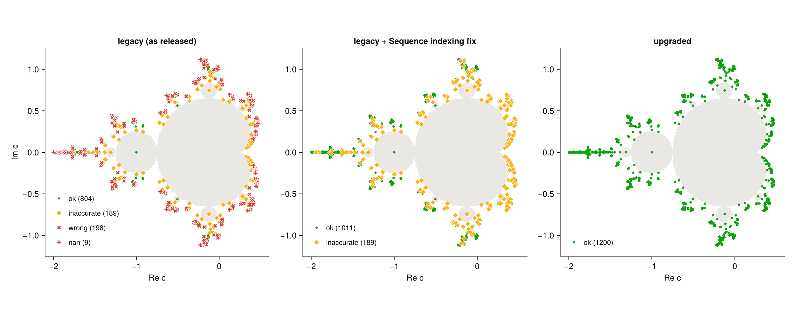
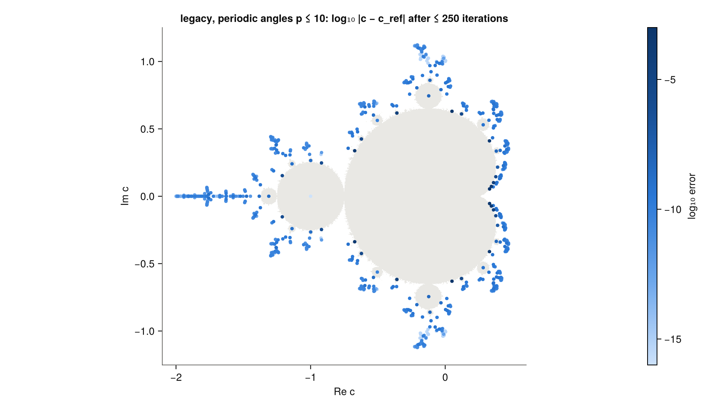
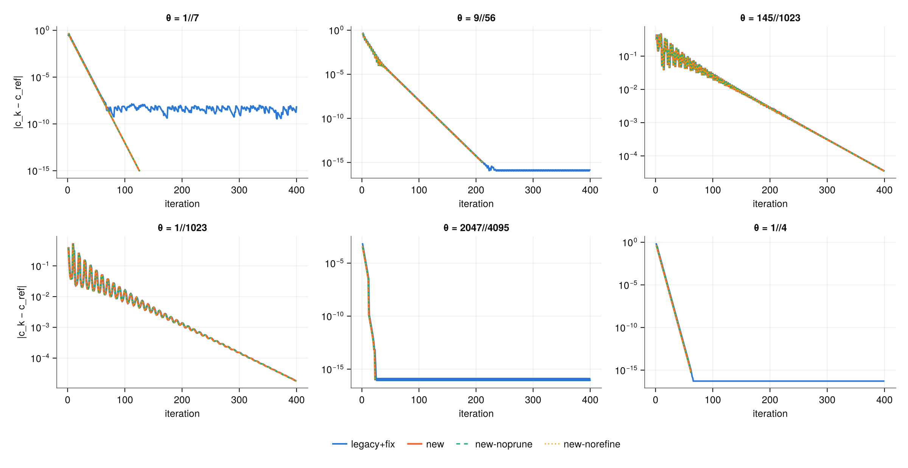
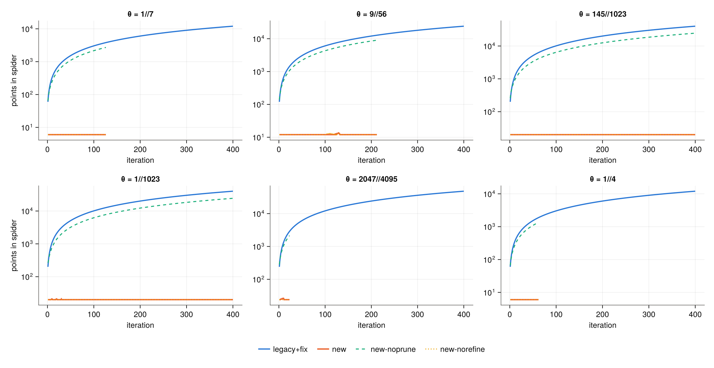
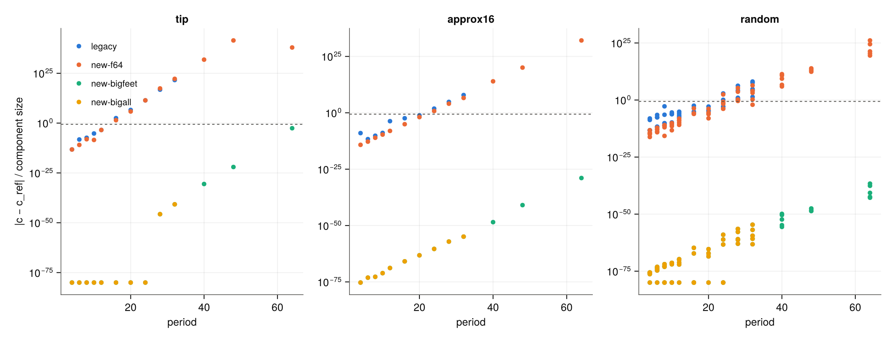

# Spider algorithm in Mandelbrot.jl: where it works, where it fails, and an upgrade

*Report for the maintainer of [jeffwack/Mandelbrot.jl](https://github.com/jeffwack/Mandelbrot.jl),
based on upstream `619df42`. Branch `spider-upgrade` on
[jeff-wack-bot/Mandelbrot.jl](https://github.com/jeff-wack-bot/Mandelbrot.jl/tree/spider-upgrade).
Everything here can be regenerated with the scripts in `spiderlab/` (see
[README](README.md)). Machine: Raspberry Pi 5, Julia 1.13.1, single thread.*

## TL;DR

| | legacy (as released) | upgraded |
|---|---|---|
| all periodic angles, period ≤ 10 (982) | 793 ok, **189 inaccurate** (error 1e-10 … 1e-3) | **982 ok** |
| all preperiodic angles, denominator ≤ 64 (218) | 11 ok, **198 wrong, 9 NaN** | **218 ok** |
| median iterations / time / allocation | 250 (= cap) / 0.3 s / 260 MB | **2 / 2 ms / 0.5 MB** |
| points in the spider | grows by 10·n per iteration (25 100 at p = 10 after 250 its) | **bounded**, a few per leg (median 20) |
| near the cusp, θ = 1/(2^p−1) | wrong for p ≥ 12 | ok up to p = 48 (Float64), p = 64 (BigFloat feet), 2–5 iterations |
| components smaller than 1e-16 | cannot be resolved | resolved with `feet=BigFloat` (legs stay Float64) |

Three root causes, in order of impact:

1. **A one-line indexing bug in `Sequence`** (`src/Sequences.jl`): `getindex` drops the preperiod offset
   in the periodic part, so preperiodic kneading sequences are read wrongly and the spider picks the
   wrong preimage. This alone accounts for all 207 preperiodic failures. *Fixed.*
2. **No control of leg geometry.** `grow!` adds 10 points per leg per iteration and nothing is ever
   removed (linear growth, quadratic total cost), while long chords are lifted without subdivision, so
   lifted legs can pass on the wrong side of a marked point. The visible symptom: the error stalls at
   ~1e-8–1e-9 and jitters forever (figure 2), and near the cusp the iteration wanders off to a wrong
   component.
3. **Slow linear convergence** with an absolute stopping test of 1e-15: most runs hit the 250 cap.
   Near the cusp the contraction rate tends to 1 (the plain spider needs ≈ 2p² iterations).

## 1. Test environment (`spiderlab/`)

* `LegacySpider.jl` — verbatim copy of the old `spidermap.jl`/`spiderfuncs.jl`, so old and new can be
  benchmarked in one session. A switch reproduces or fixes the `Sequence` bug.
* `GroundTruth.jl` — **independent** reference values: Newton-based tracing of the parameter ray
  R_M(θ) in BigFloat, then Newton's method for the nucleus (θ periodic) or for the deflated
  Misiurewicz equation (θ preperiodic). It shares no code with the spider, and it reproduces the
  known values (1/7 rabbit, 3/7 airplane, 1/6 → i, 1/4 → −0.2282+1.1151i, 1/2 → −2, …).
* `SpiderBench.jl` — angle families, instrumented runners (time, allocations, points, iterations),
  classification. A result is **ok** if the error is ≤ 1e-10·max(1,|c|) *and* below a quarter of
  the component size (Heiland-Allen size estimate), **inaccurate** if the component is right but
  the error is larger, **unresolved** if the result is as good as Float64 allows but the component
  is smaller than that, and **wrong** otherwise.
* Families used to probe structure: `cusp` 1/(2^p−1) (slow convergence); `tip` (2^{p−1}−1)/(2^p−1)
  (real axis next to −2, components ~4^{−p}, many legs near the real line); `approx16` and
  `approx14` (periodic approximants of the Misiurewicz angles 1/6 and 1/4; small components,
  clustered postcritical points); `doubling` (Feigenbaum cascade); `random`.

## 2. Map of the legacy implementation

*Figure 1. Each dot is the reference parameter of one angle (θ and 1−θ mirrored). Left: as released.
Middle: with only the `Sequence` fix. Right: upgraded.*

* **Preperiodic angles (Misiurewicz points): broken everywhere** because of the indexing bug.
  The spider for 1/6 jumps to c = −1, and 1/4 gives NaN, because legs 1 and 3 receive the same
  preimage. With the fix, all 218 are correct (median 113 iterations).
* **Periodic angles, small period: the right component, but often inaccurate.** 19% of angles with
  p ≤ 10 end more than 1e-10 off (worst 1e-3, i.e. 5–8% of the component size, for 145/1023,
  1/1023). Raising the cap does not help: at 3000 iterations 145/1023 is still 1e-9 off, the spider
  has 300 100 points, and the run allocated 42 GB.

*Figure 1b. Legacy error for periodic angles: the bad regions are the cusp area of the main cardioid
and the bulbs attached near it, i.e. the slowly converging angles.*

*Figure 2. Error |c_k − c_ref| per iteration. Legacy (+indexing fix) stalls at ~1e-8 for 1/7 and
jitters; the upgraded spider map (without the Newton endgame) converges linearly to machine precision.
The three upgraded variants coincide where they are all correct.*

*Figure 3. Points in the spider. Legacy grows by 10 points per leg per iteration; the upgraded spider
stays at a few points per leg.*

* **Larger periods** (`spiderlab/results/scaling.csv`, figures `scaling_*.png`):
  * `cusp`: legacy is inaccurate for p ≤ 10 and lands on the **wrong component for every p ≥ 12**.
  * `doubling`: inaccurate at every p (error 1e-8 … 3e-6 after 250 iterations).
  * `tip`, `approx14`, `approx16`: accurate while the component is resolvable in Float64. Beyond
    that (p ≳ 16–24) no Float64 method can identify the component (see §5).
  * Cost: 250 iterations and 0.2–0.9 GB allocated per call for p = 8…32. The final spider has
    10·n·(iterations+1) points.

## 3. What was changed (`src/spidermap.jl`)

The public API is unchanged (`standardspider`, `spider_map`, `spideriterates`, `parameter(θ, maxiter)`,
`Spider.legs` as used by BrotViz); `Spider` gains a `feet` field. New: `spider_solve` (returns a
`SpiderResult` with iterations, how it finished, component size), `certify`, `newton_feet`,
`SpiderOptions`.

1. **Exact lifting by continuation, no branch cut.** A straight segment that misses 0 subtends < π
   at the origin, so its continuous square root subtends < π/2. The correct root at the next vertex
   is the one with Re(conj(√a)·√b) > 0. This replaces `path_sqrt`'s cut along [−1000, 0] and the
   segment–cut intersection test (which fails for points on the cut, cf. issue #8, and for legs
   beyond −1000).
2. **Branch choice at infinity.** Leg 1 is the lift of leg 2 whose foot is u = +1 (z = 0). Every
   other leg is the lift whose shoulder direction differs from leg 1's by θ_i − θ_1. This is
   equivalent to the kneading rule, but needs no sector bookkeeping and no float equality tests.
3. **Refinement.** Before a segment is lifted, it is subdivided if it sweeps more than 0.5 rad
   around the critical value, or if the deviation between the lifted chord and the true lifted
   arc exceeds half the distance from the chord to any possible new marked point (both preimages
   of every foot; sorted-by-x point set for the query).
4. **Pruning.** After lifting, a vertex is removed if the triangle with its neighbours contains no
   marked point. That is a homotopy rel the marked points, so the class of the leg is unchanged.
   This replaces `grow!`, together with a single radial extension of each lifted shoulder back to
   radius 10⁶.
5. **Feet carried separately**, in a precision that may differ from the legs (`feet=BigFloat`).
   The legs only decide branches; each foot is the exact lift 2(±√(z/λ) − 1) of its source foot,
   with the sign taken from the lifted leg.
6. **Newton endgame with a certificate.** Whenever the spider step has halved since the last try,
   a *multiple-shooting* Newton iteration starts from the whole critical orbit (unknowns c and
   Z_i = c(1+z_i/2); bidiagonal system eliminated in O(n)). Its basin is far larger than that of
   Newton on f_c^p(0) = 0: for θ = 1/(2^18−1) it finds the right root from the spider at iteration
   20 (spider error 0.12), while single-shooting Newton keeps jumping to other roots. A root is
   accepted only if
   * it has the exact type of θ (no lower period / preperiod; Newton happily finds c = 0), and
   * `certify` passes. The feet are dragged along straight paths to the candidate's orbit (no path
     may cross another leg or path, so this is an isotopy), then one spider step is applied. For
     every foot, the legs must select the preimage that is the actual orbit point, *and* every
     lifted leg must be homotopic to the old one. The leg test uses winding numbers of
     (old leg ∪ arc at ∞ ∪ new leg) around the other feet, which must all be equal because arcs to
     ∞ are defined up to a full twist. Together this says the moved spider is a fixed point, which
     by Thurston rigidity is unique.

   If certification is inconclusive (feet merge, as for Misiurewicz angles like 9/56 where the
   rays 1/7, 2/7, 4/7 share a landing point; or feet closer than the leg precision), Newton is
   trusted only when the last ≥ 4 steps decrease geometrically and the a-posteriori error
   Δ·r/(1−r) is below 1e-3 × component size.
7. **Stopping** is relative (8·eps(T)·max(1,|c|)) instead of an absolute 1e-15.
8. A warning is issued when orbit angles are closer than 1e3·eps(legs) (p ≳ 42 for Float64 legs):
   the leg shoulders can then no longer be separated.

### Ablation (all periodic angles p ≤ 9 and preperiodic denominators ≤ 48, 609 angles)

| variant | wrong | median points | median MB | comment |
|---|---|---|---|---|
| upgraded | 0 | 18 | 0.4 | |
| without Newton endgame | 0 | 18 | 2.9 | median 105 iterations instead of 2 |
| no pruning (no Newton) | 0 | 6 069 | 23 | points grow like legacy |
| **no refinement** | **26 (32 without Newton)** | 18 | 0.35 | pruned legs have long chords → wrong homotopy class |
| neither (no Newton) | 0 | 889 | 2.8 | dense legs keep chords short |

**Pruning requires refinement.** Legacy survives without refinement only because it never prunes:
its dense legs keep chords short. That's also why it can't bound memory. Without refinement the
certificate can even confirm a wrong root, because it checks consistency with the legs, and the
legs themselves are then in the wrong class.

### Certificate soundness (`results/certify_soundness*.csv`)

For every angle of period ≤ 9, every nucleus of period ≤ 9 dividing p was offered as a candidate to
spiders after 1, 2, 3, 5, 10 and 20 iterations. The same was done for preperiodic types up to (1,12),
offering every Misiurewicz point of lower or equal type and every nucleus. Results:

| certificate variant | correct candidate certified | wrong candidate certified |
|---|---|---|
| move < ¼ of room, feet only | 801 / 2 922 (only late) | 0 |
| isotopy, feet only | 2 406 / 2 922 | **59** |
| **isotopy, feet + leg windings (default)** | 2 406 / 2 922 (+2 718 / 3 288 in the extended test) | **0** of ≈ 7 900 that reached the lift test (≈ 1.17 M more stopped at the isotopy check) |

The leg check is what makes the certificate safe: the feet-only check accepted 59 wrong nuclei,
and all of them are rejected with the leg check. This is strong empirical evidence, not a proof.
Winding numbers are an abelian invariant, and a full homotopy test would compare words in the free
group.

## 4. Performance

Steady state (`results/timing.csv`, min of 3 runs; bytes = total allocation):

| family | p | legacy | upgraded Float64 | upgraded BigFloat feet |
|---|---|---|---|---|
| cusp | 16 | wrong, 250 it, 1.18 s, 455 MB | 2 it, 2.4 ms, 0.9 MB | 2 it, 4.2 ms |
| cusp | 32 | wrong, 1.79 s, 856 MB | 3 it, 8.6 ms | 2 it, 11.8 ms |
| cusp | 64 | — | **wrong** (warning issued) | 4 it, 76 ms |
| doubling | 32 | inaccurate, 1.16 s, 885 MB | 46 it, 32 ms | 46 it, 105 ms |
| approx16 | 16 | 0.56 s, 476 MB | 14 it, 6.7 ms | 14 it, 22 ms |
| approx16 | 64 | — | unresolved | 505 it, 3.6 s |
| tip | 32 | unresolved | unresolved | 65 it, 0.26 s |

One `spider_map` step (p = 30, ~70 points): 1.3 ms with Float64 feet, 1.7 ms with BigFloat feet,
230 ms with BigFloat legs as well. Profile: ~60% in segment lifting/refinement, ~45% of which is the
obstacle distance query (`mindist`). Possible next steps: a spatial grid for the obstacle query,
and reusing the lifted shoulder segments, which are radial and never need refinement.

## 5. When is arbitrary precision needed? Can it be limited to the landing points?

*Figure 4. Error relative to component size (dashed: ¼, above it the component is misidentified).*

* **Float64 suffices for the answer** as long as the component is larger than ~1e3·eps·|c|. In
  the experiments that means up to p ≈ 14 (tip), 20 (approx16/approx14), 25–30 (random angles),
  and far beyond for cusp/doubling, whose components are large. `spider_solve` returns `size`, so
  callers can check `r.size > 1e3*eps()*abs(r.c)`. Beyond that, *any* Float64 result is within 1e-16
  of the true center but does not identify the component. Legacy and upgraded Float64 behave the
  same there ("unresolved").
* **Arbitrary precision only on the landing points works.** With `feet=BigFloat` and Float64 legs,
  every case tested up to p = 64 was correct (tip, approx16, approx14, random, doubling, cusp),
  including tip p = 30, where feet are only 1e-16 apart. The reason: lifting a foot only needs
  the *sign* of √(z/λ), which the Float64 leg determines with about half the digits (√ of a
  distance). Cost is 1.3–4× the Float64 run, versus ~150× per step for BigFloat legs.
* **Where feet-only precision stops:**
  1. *Orbit angles closer than eps of the legs.* For p ≳ 50 the shoulders at radius 10⁶ collapse
     (cusp p = 64 with Float64 legs is wrong). A warning is printed. The fix would be log-polar
     coordinates for the shoulder region or BigFloat legs.
  2. *Feet closer than Float64 resolution.* Here the certificate is inconclusive and the run falls
     back to the slower trusted-Newton path (tip p ≥ 32: 65–127 iterations). In tip p = 64 it
     finished at 3e-3 of the component size without polishing. A natural extension is to store leg
     vertices as Float64 *offsets from the nearest foot* (perturbation theory, as in deep-zoom
     renderers), which would make the leg geometry resolvable at any depth.

## 6. Strategies for pruning and refining legs: summary

* Only the homotopy class of each leg rel the marked points matters (leg-leg crossings are
  harmless in themselves), so **topological** criteria are the right ones.
* **Refine** in the source plane before lifting, with two tests: (a) angular sweep around the
  critical value ≤ 0.5 rad, and (b) chord-vs-arc deviation < ½ × distance to the nearest possible
  new marked point. Check deviations at rounding level, otherwise merged feet cause endless
  subdivision.
* **Prune** greedily with the empty-triangle test against the new marked points. Each removal is
  a homotopy across an empty triangle, so the result is a near-taut polyline: 2–8 points per leg.
* Keep shoulders on a fixed large circle and choose branches by tail direction. The tail angles
  only need to be right to within ¼ turn.

## 7. Other findings, decisions and caveats

* `Sequence` `getindex` bug (preperiod offset) affects any caller that indexes preperiodic
  sequences beyond the preperiod. The existing tests still pass after the fix. I did not audit
  the other callers (`HubbardTrees.jl`, internal-address code) for behaviour that depended on the
  bug.
* `orbit` uses `Rational{Int}` arithmetic for `Rational{Int}` input, which overflows for p > 62.
  Pass `Rational{BigInt}` for large periods (the lab does).
* `HyperbolicComponent` still calls `parameter(standardspider(θ), 250)`; it now gets the
  upgraded result.
* New test file `test/testspider.jl` (Literate style, 20 tests) and a docs section in
  `docs/src/spider.md`. **The docs build was not run** (it needs BrotViz/CairoMakie in the docs env).
* The extended soundness experiment (`certify_soundness2.jl`) was stopped by hand after 24 h. It
  had finished every periodic case and the preperiodic types up to (1,12), with no false positives,
  then stopped progressing on the next preperiodic type. I did not identify which candidate
  stalls it. A `certify` call that runs for hours is a performance bug worth investigating (a
  candidate that forces unbounded refinement is my guess).
* Decisions taken without asking: target `jeffwack/Mandelbrot.jl` (the package with the spider; the
  other packages of that name are renderers). Keep the public API and the `legs` layout used by
  BrotViz. Default `feet=Float64` for speed. Newton endgame on by default (`polish=false` gives the
  plain spider). Changes pushed to a fork branch; no PR opened upstream.
